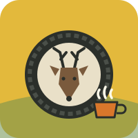

<p align="center"></p>

# Coffee Craft Racing

A casual 3D racing game for desktop and mobile browsers, forked from Coffee Craft v1.0.1. Race a driverless robo-taxi
down a forest highway, through the pink haze into town, and out to the pier. Grab coffee at roadside stands, chat with
the baristas, earn points and unlock new cars. Created by [Daniel McKeown](https://altaredwood.work).

## Run it

It is a static site (ES modules, no build step), so any static host works and **PHP is not required**.

```
python -m http.server 5199     # or: npx vite dev / npx serve
```

Open `http://localhost:5199/`. Without PHP the game runs in "static mode": the AI barista and phone chat use built-in
fallback lines and saves go to browser `localStorage`. If `api.php` is available, accounts, server saves and the
optional AI proxy light up automatically (see `config.local.php.example`).

## Playing

| Control | Keys | Button |
|---|---|---|
| Steer | ← → / A D | on-screen pad |
| Gas | `.` / ↑ / W | ⏩ right |
| Brake / reverse | `,` / ↓ / S | 🛑 bottom |
| Horn | `/` | 📣 left |
| Coffee | `'` | ☕ top |
| Pause / Phone / Mute | P or Esc / Tab / M | |

- **☕ Coffee**: slow down near a roadside stand and press it to pull in (menu on one side, barista chat on the other;
  stacked on narrow screens). Otherwise it drinks a carried coffee (max 3) for a 5-second boost.
- **Points & cars**: 1st place gives 80 points, 2nd gives 30. The Skyview CUV unlocks at 100, the City Bus at 300 and the
  Redwood RS (rear-wheel-drive sports car) at 600.
- **Difficulty**: Normal (relaxed robo-taxi, scales with your points) or Challenging (all-out, 1.5× points). Change it
  before a race or in Phone → Settings → Stats.
- **Phone**: kept from Coffee Craft. **Coffee Guru** replaces Car Stealer and is the roast lab; **Map** shows the course.

## Status

Level 1 (Forest Road to Harbor Town) is playable. The Alpine Pass and Sunland Canyon roads are listed as "coming soon".

## Layout

- `js/cars.js`, `js/track.js`, `js/race.js`, `data/tracks.json`: cars, course building, physics and robo-taxi AI.
- `js/main.js`: game loop, menus, coffee stands, rewards. `js/phone.js`: the smartphone.
- Town, weather, economy, audio and AI helpers are inherited from Coffee Craft.
